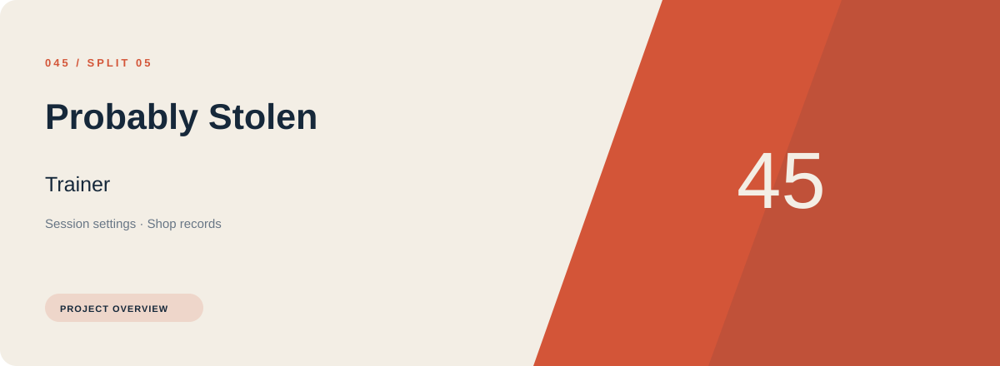
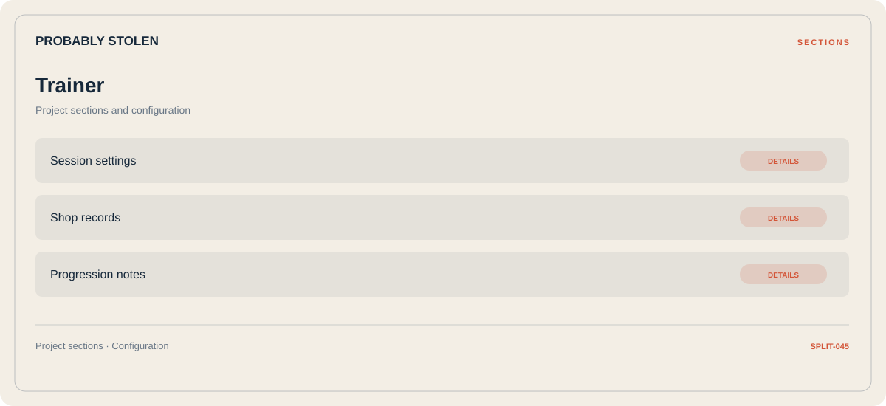

# 🎮 Probably Stolen Trainer

**Session settings · Shop records · Progression notes**

## ⚡ Features

Probably Stolen Trainer brings session settings and shop records into one section-based interface. Progression notes provides the third part of the workflow.

### ⚙️ Session settings

Session and activity information grouped by the task or context it belongs to.

### 🧩 Shop records

A dedicated section for shop records and the configuration details associated with that area.

### ⌨️ Progression notes

A dedicated section for progression notes and the configuration details associated with that area.

## 🖥️ Project navigation

## 📥 Download

The button and cover open the project's download page. Use the information supplied with the downloaded package for installation and release-specific requirements.

## 📚 Project documentation

- [Feature reference](docs/FEATURES.md)
- [Download information](docs/DOWNLOAD.md)
- [Project page](index.html)

---

Probably Stolen Trainer · Program documentation and download information.
